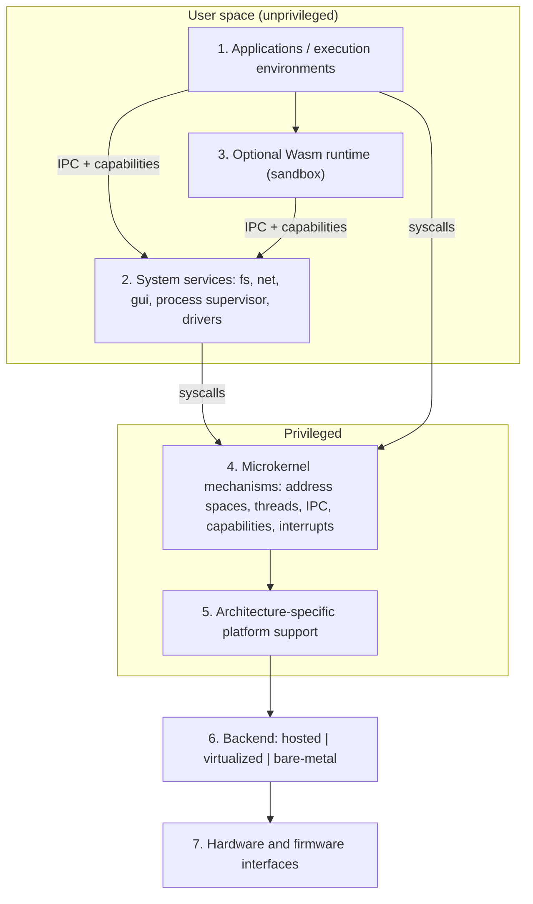

# OMNI-Kernel Architecture

**Document status:** Batch 1 specification. Everything below is a design decision, proposal, or open question. Nothing is implemented or verified. Status terms used throughout:

- **Decision** — a choice made for Batch 1, open to revision by later review.
- **Proposed** — a design offered for review.
- **Planned** — intended for a future batch.
- **Open question** — unresolved; options and a provisional recommendation are given where possible.

Terminology is shared with `docs/ABI-AND-SECURITY.md`. The ABI version label is **OMNI-ABI 0.1 (draft)**.

---

## 1. Purpose and scope

This document describes the intended structure of OMNI-Kernel: its layers, the boundaries between them, which functions are privileged, and how the system is expected to boot, schedule, communicate, and be tested. It justifies choices and records trade-offs. It does not describe an existing system.

## 2. Design principles

1. **Mechanism in the kernel, policy in user space.** The kernel provides primitives; services decide how to use them.
2. **Authority is explicit.** All access is mediated by capabilities. There is no ambient authority such as "run as root".
3. **Small privileged surface.** Every function added to the kernel enlarges the code that can compromise the whole system. Additions require justification.
4. **Failure is contained.** A crashing driver or service must not take down the kernel or unrelated services.
5. **Backends are different environments.** Hosted, virtualized, and bare-metal execution have different guarantees and are never treated as equivalent.
6. **Honest scope.** The design is ambitious but does not promise a universal binary, seamless cross-OS compatibility, formal verification, or production readiness.
7. **Incremental adoption.** The design must allow Exile OS to adopt OMNI-Kernel piece by piece.

## 3. Layer model

The system is arranged in seven layers. Dependencies point **downward only**: a layer may depend on layers below it, never above.

| # | Layer | Privilege | Trust |
|---|---|---|---|
| 1 | Applications and user-space execution environments | User | Untrusted |
| 2 | User-space system services | User | Semi-trusted per service, each isolated |
| 3 | Optional WebAssembly runtime | User | Untrusted input handler, sandboxed |
| 4 | Native microkernel mechanisms | Privileged | Trusted computing base |
| 5 | Architecture-specific platform support | Privileged | Trusted computing base |
| 6 | Execution backends (hosted, virtualized, bare-metal) | Varies by backend | See section 14 |
| 7 | Hardware and firmware interfaces | Hardware | Assumed to behave per specification, with caveats |

Layer 3 sits beside layer 1 in terms of authority (it is an execution environment hosting applications) but is listed separately because it has its own sandbox boundary and its own risks.

The diagram is illustrative. The prose in the following sections is the normative description.

### 3.1 Layer 1 — Applications and execution environments

Applications are user-space programs. They hold only the capabilities they were given at creation or later received over IPC. An *execution environment* is a user-space runtime that hosts foreign code: a native process environment, a Wasm runtime, or a compatibility layer. Execution environments are ordinary user-space components and receive no extra kernel privilege.

### 3.2 Layer 2 — User-space system services

Services provide the functionality behind the seven logical interfaces: `omni_fs`, `omni_net`, `omni_process`, `omni_ipc`, `omni_clock`, `omni_random`, `omni_gui`. Some interfaces are served by user-space services (`omni_fs`, `omni_net`, `omni_gui`, and most of `omni_process` policy); others are thin kernel-backed interfaces (`omni_ipc`, the core of `omni_clock` and `omni_random`). Section 5 explains the split. Device drivers are also layer-2 components.

### 3.2.1 Service isolation

Each service runs in its own address space with a minimal capability set. A service that needs hardware receives only the specific device and DMA capabilities for it. Services are expected to be restartable (section 13.4).

### 3.3 Layer 3 — Optional WebAssembly runtime

The Wasm runtime is an optional user-space service that executes Wasm modules. Boundaries:

- A Wasm module's linear memory is separate from host memory; the runtime enforces bounds.
- A module reaches system functionality only through host functions that the runtime maps onto capabilities. A module cannot gain a capability the runtime does not hold.
- The runtime process is itself isolated by the kernel. Sandbox escape from the Wasm engine should yield only the runtime's own capabilities.
- Wasm is **not** used for drivers, for kernel code, or as a replacement for native execution of system services.
- Which host interface (for example a WASI-style interface) the runtime exposes is an **open question** (section 15.3).

### 3.4 Layer 4 — Native microkernel mechanisms

The privileged kernel is intended to provide only:

- Physical memory management primitives and address-space/page-table management.
- Thread objects and the scheduler core.
- Synchronous and asynchronous IPC, including handle transfer.
- The capability table and rights checking.
- Interrupt and exception routing to user space and kernel handlers.
- Minimal clock and entropy primitives that user space cannot safely implement.
- Resource accounting and limit enforcement hooks.
- Early diagnostics (a bounded kernel log).

### 3.5 Layer 5 — Architecture-specific platform support

Isolates everything that differs per CPU: trap and syscall entry, context switch, page-table formats, interrupt controller drivers needed by the kernel, timer and cycle-counter access, atomics and barriers, and cache maintenance. It presents a single internal **platform interface** to layer 4. Initial targets are x86-64 and ARM64; RISC-V is considered in the interface design so it is not baked out.

### 3.6 Layers 6 and 7 — Backends, hardware, and firmware

Backends supply the platform interface in three different ways (section 14). Hardware and firmware (UEFI, device tree, ACPI, SBI, microcode, device firmware) are inputs the kernel must validate rather than trust blindly; firmware and device behaviour are in part out of scope for the threat model (see `docs/ABI-AND-SECURITY.md`).

## 4. Trust boundaries, dependency direction, and failure isolation

**Trust boundaries.**

1. *User/kernel boundary.* Every syscall argument is untrusted. Pointers, lengths, identifiers, and handles are validated (see `docs/ABI-AND-SECURITY.md`).
2. *Process/process boundary.* Enforced by separate address spaces and the capability table. Communication only via IPC.
3. *Service/client boundary.* A client does not trust a service's replies for its own safety; a service does not trust client requests.
4. *Driver/device boundary.* Devices are untrusted data sources and, with DMA, potential memory writers. The IOMMU (or equivalent) is the intended mitigation; its availability varies by platform and is a stated limitation.
5. *Runtime/guest boundary* (Wasm or compatibility layers).
6. *Backend boundary.* The kernel's assumptions about privilege differ per backend.

**Control flow.** A typical filesystem read: application → IPC to the filesystem service using an `omni_fs` capability → the filesystem service sends a block request over IPC to a storage driver using a device-client capability → the driver programs the device with DMA limited to a granted buffer → interrupt delivered by the kernel to the driver → reply propagates back. The kernel moves messages and handles; it does not interpret filesystem or block semantics.

**Dependency direction.** Downward only. The kernel depends on no user-space service. Services depend on the kernel ABI and on each other only through IPC interfaces, with acyclic startup ordering during boot (section 6).

**Failure isolation.** A fault in a driver or service terminates that component; clients receive a defined error (`PEER_DEAD`, see ABI document) and capabilities held by the dead component are released by the kernel. A kernel fault is fatal to the system; this is why the kernel surface is kept small.

## 5. Kernel space versus user space

The central trade-off is between a smaller trusted computing base (TCB) and the cost of more IPC and context switches. The table records the proposed placement and rationale.

| Function | Placement | Rationale | Trade-off |
|---|---|---|---|
| Page-table manipulation, address spaces | Kernel | Hardware-privileged and security-critical | Larger TCB |
| Scheduler core and context switch | Kernel | Needs privilege; latency-sensitive | Policy flexibility reduced; policy hooks planned |
| IPC and handle transfer | Kernel | The mediator of all authority | Performance-critical; must be carefully bounded |
| Capability table | Kernel | Unforgeability requires kernel custody | Revocation complexity (see ABI document) |
| Interrupt routing | Kernel | Must acknowledge and mask at privilege | Handlers kept minimal; device work in user space |
| Monotonic clock source, entropy pool seeding | Kernel | Hardware access and trust anchor | Entropy design is a hard problem; limitations documented |
| Device drivers | User space | Isolation; crash containment | IPC overhead; DMA protection depends on IOMMU |
| Filesystems | User space | Large, complex, parser-heavy code | Latency; caching coordination |
| Network stack | User space | Large, complex, attacker-facing | Copy overhead; zero-copy needs shared-memory design |
| GUI/compositor | User space | Large and complex | Input latency |
| Process supervision, naming, policy | User space | Policy, replaceable | Bootstrapping order |
| Wasm runtime | User space | Large and untrusted-input-facing | Never privileged |

Kernel-resident drivers are **not** proposed, with one provisional exception to be reviewed: the minimal interrupt controller and timer drivers required by the kernel itself. Performance-critical drivers such as storage and network may later receive optimized user-space data paths (shared rings, polling) rather than moving into the kernel.

## 6. Boot and initialization phases

Phases are conceptual. Concrete details differ by backend and architecture. **Planned**, not implemented.

| Phase | Activity | Notes |
|---|---|---|
| 0. Firmware handoff | Firmware or VMM transfers control; boot information structure received | Treated as untrusted input; validated |
| 1. Early platform init | Minimal stack, serial/console, CPU feature detection, exception vectors | Assembly permitted |
| 2. Memory discovery | Parse memory map; initialize physical allocator | Overlap and overflow checks on firmware-reported ranges |
| 3. Kernel address space | Establish kernel page tables; enable protections available on the CPU | |
| 4. Core objects | Initialize scheduler, capability table, IPC structures, entropy pool seeding | Seeding quality depends on platform (see ABI document, `omni_random`) |
| 5. First user process | Create the *init* process with a bootstrap capability set | Init is the root of delegation |
| 6. Service startup | Init (or a supervisor) starts services in dependency order: random/clock, storage drivers, filesystem, network, GUI | Startup graph must be acyclic |
| 7. Steady state | Normal operation | |

Early failures in phases 0–4 halt the system with a diagnostic; later failures are handled by the supervisor.

## 7. Address spaces and virtual memory

- Each process has its own address space. The kernel owns page tables; user space requests mappings through capabilities to memory objects.
- **Decision:** user memory is described by *memory objects* (kernel-held, capability-referenced) that can be mapped into one or more address spaces. This supports shared memory for IPC bulk data and device buffers without the kernel interpreting contents.
- Kernel memory is never directly mappable by user space.
- Enforcement of write-xor-execute, guard pages, and similar mitigations is a *goal* subject to architecture support and is not claimed as implemented.
- Page-fault handling: faults that are not resolvable by the kernel are reported to a designated fault handler (a user-space pager or supervisor) through IPC, so memory policy can live outside the kernel.
- Cross-process memory access occurs only via explicitly shared memory objects; no capability grants "read arbitrary memory of another process" by default. A debugging capability for that purpose is an **open question** (section 15.3).

## 8. Scheduling and thread lifecycle

- Threads are kernel objects belonging to a process. States: *created*, *ready*, *running*, *blocked* (on IPC, wait object, or timer), *terminating*, *terminated*.
- **Decision (provisional):** a priority-based preemptive scheduler with per-CPU run queues and time slices as the first implementation, chosen for simplicity and testability. Alternatives (deadline scheduling, scheduling-context donation to bound priority inversion during IPC) are retained as options. Priority inversion over IPC is a known problem; the mitigation is an open design item.
- Scheduling parameters are governed by capabilities; a process cannot raise its own priority above a ceiling granted to it.
- Termination: a thread blocked in a kernel operation is moved to *terminating* and the blocked operation is cancelled according to the cancellation rules in the ABI document. Resources are released only after the thread is confirmed out of kernel code.

## 9. Inter-process communication

IPC is the fundamental mediator. Proposed model:

- **Channels** with two endpoints, each referenced by a handle. Messages consist of a bounded byte payload plus a bounded number of transferred handles.
- **Synchronous call** (send request, wait for reply) and **asynchronous send** with bounded queues. Queue depth is bounded per channel and accounted to the sender or receiver (policy: provisional, sender-charged for in-flight bytes).
- **Handle transfer** moves or duplicates a capability into the receiver's table, subject to rights (the *transfer* right and optionally *duplicate*).
- Large data uses shared memory objects, with messages carrying only the handle.
- Peer death closes the channel; waiting operations complete with `PEER_DEAD`.
- Message contents are untrusted by the receiver. The kernel validates structure (sizes, handle counts); services validate semantics.

## 10. Capability-based access control

- A capability is a **kernel-held entry** consisting of a reference to an object, a rights bitmask, and bookkeeping (generation, derivation parent). User space holds an opaque **handle** that indexes the holder's per-process table. Handles are meaningless outside their owning process and cannot be forged by guessing because the kernel validates index, generation, and rights on every use.
- Capabilities may be *derived* with equal or reduced rights, *transferred* over IPC, and *released*. *Revocation* of previously delegated authority is desired but difficult; options and a provisional recommendation are in `docs/ABI-AND-SECURITY.md`. **Revocation is not implemented.**
- Services implementing resources (for example files) typically use *service-side objects*: the kernel capability refers to an IPC endpoint, and the service tracks per-client state. This keeps filesystem semantics out of the kernel.
- There is no global namespace by default. Naming is supplied by a user-space service that hands out capabilities.

## 11. Interrupt handling, device interaction, and driver placement

- The kernel handles the CPU-level interrupt, masks the source if required, and **delivers a notification** to the owning driver through a notification object. The driver performs device-specific work in user space.
- Device access is through capabilities for specific MMIO regions, I/O ports (x86-64), interrupt lines, and DMA-capable buffers.
- DMA is the principal hazard: a malicious or buggy device or driver with unrestricted DMA can overwrite any memory. The intended mitigation is IOMMU-mediated DMA where the platform provides one. Where it does not, drivers for DMA-capable devices must be treated as part of the TCB for that machine. This is a **stated limitation**, not a solved problem.
- Drivers run with the minimum device capabilities and are supervised and restartable. Restart safety requires drivers and clients to tolerate loss of in-flight requests; device reset behaviour is device-specific.
- Level versus edge triggering, interrupt storms, and shared lines must be handled by the kernel's rate-limiting and masking policy to prevent a misbehaving device causing denial of service.

## 12. System services

### 12.1 Filesystem and storage

A storage driver exposes block access; a filesystem service implements file semantics and serves `omni_fs`. Separating them allows swapping filesystems and isolates parser-heavy code. Filesystem services cache data; cache coherence with shared-memory clients is an open design area. Filesystem formats and journaling choices are not decided in Batch 1.

### 12.2 Networking

A network driver provides frame access; a network service implements protocols and serves `omni_net`. Sockets are service-side objects. Raw access to frames requires a distinct, highly restricted capability. Protocol support is not specified in Batch 1.

### 12.3 Time and random-number services

- **Time.** The kernel provides a monotonic clock. Wall-clock time is a service concern (it can be adjusted and may be untrusted). Timers are kernel objects used by the scheduler and exposed through `omni_clock`.
- **Randomness.** The kernel holds an entropy pool seeded from platform sources, and exposes `omni_random`. Quality depends on hardware and firmware sources, especially early in boot and in virtual machines. Hosted mode uses the host's randomness and provides no independent guarantee. Details and limitations are in the ABI document.

### 12.4 GUI and graphics

A compositor service owns display hardware (via a graphics driver) and arbitrates surfaces and input. Clients obtain surfaces and input only through `omni_gui` capabilities. Input routing is a major confidentiality concern (keystroke snooping, screen scraping), so default isolation between surfaces is required: a client sees only input directed to its focused surface. Graphics acceleration and GPU isolation are not specified in Batch 1.

## 13. Observability, accounting, cancellation, and recovery

### 13.1 Logging and diagnostics

The kernel keeps a bounded ring-buffer log, readable only by a holder of a log capability. A user-space logging service aggregates structured events. Security-relevant events (denied capability use, validation failures, quota hits) are recorded with rate limiting so logs cannot be used for denial of service. Logs must not record secret material.

### 13.2 Resource accounting and quotas

Every kernel object is charged to a **resource account** attached to a process or service. Accounts have limits (memory pages, handles, threads, channels and queued bytes, CPU share). Exceeding a limit yields `QUOTA_EXCEEDED` rather than allocation. Accounting must handle shared objects (charge to creator versus split); the provisional choice is charge-to-creator with transfer of charge as an explicit operation.

### 13.3 Cancellation

Blocking operations accept a cancellation handle. The desired semantics, defined in the ABI document, are that cancellation is *requested* asynchronously and the operation completes with `CANCELLED` or its real result, with all resources released exactly once. **Synchronous guaranteed cancellation is not claimed**; cancelling an operation already committed to hardware or to a remote peer may not be immediately possible.

### 13.4 Failure recovery

A supervisor restarts failed services according to a policy and re-issues capabilities. Clients holding handles to a dead service receive `PEER_DEAD` and must re-acquire. Stateful services need explicit recovery protocols. Total recovery from arbitrary failures is not promised.

## 14. Execution backends, portability, and testing

### 14.1 Three backends, three environments

| Property | Hosted | Virtualized | Bare-metal |
|---|---|---|---|
| Runs as | Process on host OS | Guest in a VM | Directly on hardware |
| CPU privilege | None (host user mode) | Guest ring 0 / EL1 | Ring 0 / EL1 (and firmware) |
| Memory protection | Host-provided, not kernel-enforced | Virtual MMU, emulated or hardware-assisted | Real MMU |
| Interrupts | Simulated via host signals/threads | Virtual interrupt controller | Real controllers |
| Devices | Host-backed emulation | Virtual devices (VMM-defined) | Real hardware |
| Timing | Host scheduling noise | Host-influenced | Real hardware timing |
| Entropy | Host | VMM-dependent, often limited at boot | Platform-dependent |
| Value | Fast iteration, determinism | Realistic privilege and boot | The actual product |
| Cannot prove | Isolation, interrupts, MMU behaviour | Real device and timing behaviour | n/a |

A hosted process is **not** a privileged kernel. In hosted mode the "kernel" is a library or process mapping kernel abstractions onto host facilities; it cannot enforce isolation against a hostile program in the same host process and does not exercise hardware paths. Security conclusions must not be drawn from hosted results.

### 14.2 Cross-architecture portability

The platform interface (layer 5) abstracts per-architecture operations. Portable code makes no assumptions about page size, endianness, cache-coherence model, memory-ordering strength, or interrupt controller. x86-64 has a strong memory model and ARM64 a weaker one; portable code must use explicit atomics and barriers. Portability is a design discipline verified by building and testing on multiple targets, not a property granted by the language.

### 14.3 Hosted development and deterministic testing

Hosted mode with a simulated clock, simulated interrupts, and seeded pseudo-random inputs is intended to allow **deterministic replay** of scheduler, IPC, and capability logic and fuzzing of parsers and validators. Determinism is limited to the simulated components; it does not extend to real hardware. A test taxonomy (unit, deterministic simulation, fuzz, VM integration, hardware) is planned for the testing stage.

### 14.4 Virtual-machine execution and eventual bare-metal boot

The first boot target is a virtual machine because debugging, snapshots, and reproducibility are better. Bare-metal boot adds firmware variation, real device quirks, and hardware errata, and is planned only after VM validation. Firmware interfaces (UEFI, device tree, SBI) are accessed only in the early platform layer.

## 15. Exile OS integration, compatibility layers, and unresolved questions

### 15.1 Preserving Exile OS

OMNI-Kernel work does not modify existing Exile OS files. The proposed integration approach is staged:

1. Documentation and interface agreement (Batch 1).
2. Independent bring-up of OMNI-Kernel in VMs.
3. Running selected Exile OS components as user-space programs or services atop OMNI-Kernel, where feasible, while the existing system remains the default.
4. Gradual replacement of Exile OS kernel functions, each reversible.

Mapping of existing Exile OS code to services is an **open question** because Batch 1 did not examine that code.

### 15.2 Compatibility layers

Compatibility layers (for example POSIX-like or foreign-binary support) are user-space execution environments that translate foreign semantics onto the native interfaces. They hold only the capabilities they are given, run in separate processes, and never gain kernel privileges. They are **not** part of the kernel's core mechanisms, which must not acquire foreign semantics. Compatibility will be partial and documented per layer; no layer is specified in Batch 1.

### 15.3 Open questions

| # | Question | Options | Provisional recommendation |
|---|---|---|---|
| Q1 | Capability revocation mechanism | Indirection/generation, derivation tree, epoch | See ABI document |
| Q2 | Priority inversion across IPC | Priority inheritance, scheduling-context donation | Decide at scheduler stage |
| Q3 | Wasm host interface | WASI-style, custom capability-native | Capability-native with a thin shim |
| Q4 | Debugging/tracing capability | Process-level, thread-level | Separate rights, off by default |
| Q5 | Zig version to pin | Latest stable at stage 1 | Decide at toolchain stage |
| Q6 | DMA protection without IOMMU | Treat drivers as TCB, bounce buffers | Document per platform |
| Q7 | Exile OS component mapping | Unknown | Requires inspection in a later batch |

## 16. Initial targets and non-goals

**Initial targets.** x86-64 and ARM64 in hosted and virtualized modes; bare-metal later. RISC-V considered in interface design, with implementation deferred.

**Non-goals.**

- A universal binary format or running arbitrary binaries from every OS.
- Seamless compatibility with every operating system or CPU.
- Formal verification or a production-readiness claim.
- In-kernel drivers, filesystems, or network stacks (beyond the minimal exception in section 5).
- Replacing Exile OS in a single step.
- Treating WebAssembly as a driver environment.
- Real-time guarantees in the initial design.
